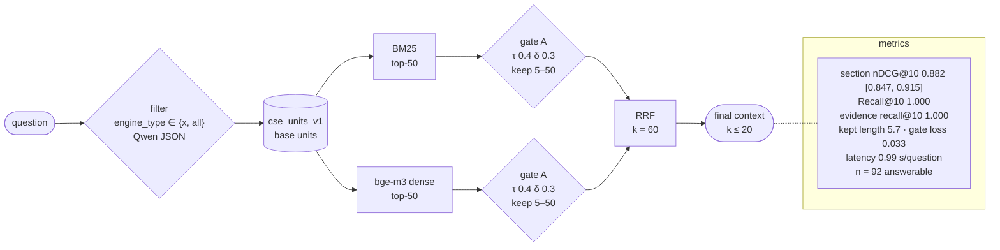

# F1-units-gateon-v1-d85f1376

F1: H1 + LLM-extracted engine-type filter · index `units` · gate on · params `v1` · config `d85f1376506a`

| comparison | Δ section nDCG@10 | 95% CI | p (Holm) |
|---|---|---|---|
| RQ5 F1 vs H1 | +0.005 | [-0.007, +0.018] | 1.0000 |
