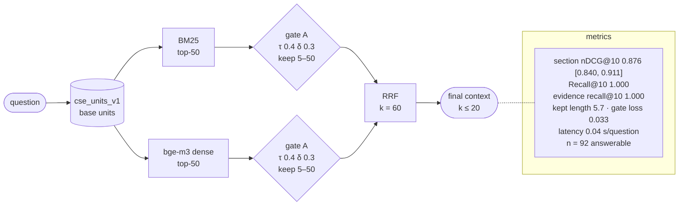

# H1-units-gateon-v1-9f5e5fd2

H1: BM25 + dense, RRF · index `units` · gate on · params `v1` · config `9f5e5fd2f264`

| comparison | Δ section nDCG@10 | 95% CI | p (Holm) |
|---|---|---|---|
| RQ2 H1 vs L1 | +0.043 | [+0.012, +0.076] | 0.0672 |
| RQ2 H1 vs D1 | +0.048 | [+0.015, +0.085] | 0.0672 |
| RQ2 H2 vs H1 | -0.009 | [-0.024, +0.004] | 0.9434 |
| RQ3 X1 vs H1 | +0.011 | [-0.015, +0.039] | 0.6897 |
| RQ3 X2 vs H1 | +0.024 | [-0.000, +0.050] | 0.2584 |
| RQ5 F1 vs H1 | +0.005 | [-0.007, +0.018] | 1.0000 |
| RQ5 T1 vs H1 | +0.000 | [+0.000, +0.000] | 1.0000 |
