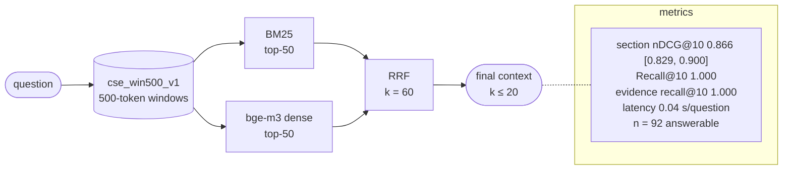

# H1-win500-gateoff-v1-9d5dfb15

H1: BM25 + dense, RRF · index `win500` · gate off · params `v1` · config `9d5dfb150d1e`

| comparison | Δ section nDCG@10 | 95% CI | p (Holm) |
|---|---|---|---|
| RQ2 H1 vs L1 | +0.014 | [-0.009, +0.038] | 0.8423 |
| RQ2 H1 vs D1 | +0.009 | [-0.018, +0.037] | 0.8423 |
| RQ2 H2 vs H1 | +0.012 | [-0.003, +0.027] | 0.5297 |
| RQ3 X1 vs H1 | +0.037 | [+0.013, +0.065] | 0.0129 |
| RQ3 X2 vs H1 | +0.056 | [+0.026, +0.087] | 0.0012 |
| RQ5 F1 vs H1 | +0.019 | [+0.009, +0.031] | 0.0008 |
| RQ5 T1 vs H1 | +0.000 | [+0.000, +0.000] | 1.0000 |
| RQ7 H1@win500 vs H1@units | -0.004 | [-0.025, +0.017] | 1.0000 |
