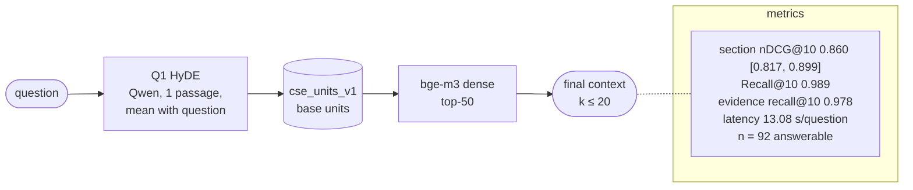

# Q1-units-gateoff-v1-73502117

Q1: HyDE (dense) · index `units` · gate off · params `v1` · config `73502117bcc2`

| comparison | Δ section nDCG@10 | 95% CI | p (Holm) |
|---|---|---|---|
| RQ4 Q1 vs D1 | +0.011 | [-0.013, +0.039] | 0.4027 |
