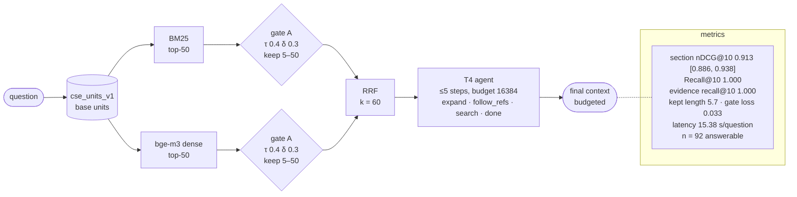

# T4-b16k-units-gateon-v1-f395387b

T4: H1 -> agentic small-to-big · index `units` · gate on · params `v1` · config `f395387b14d4`

| comparison | Δ section nDCG@10 | 95% CI | p (Holm) |
|---|---|---|---|
| RQ6 T4 vs T2+T3 | -0.001 | [-0.039, +0.040] | 1.0000 |
