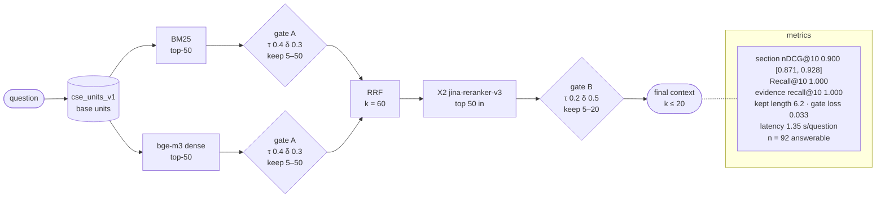

# X2-units-gateon-v1-b3ace7ee

X2: H1 -> jina-reranker-v3 · index `units` · gate on · params `v1` · config `b3ace7eea425`

| comparison | Δ section nDCG@10 | 95% CI | p (Holm) |
|---|---|---|---|
| RQ3 X2 vs H1 | +0.024 | [-0.000, +0.050] | 0.2584 |
| RQ3 X1 vs X2 | -0.013 | [-0.027, +0.000] | 0.2584 |
