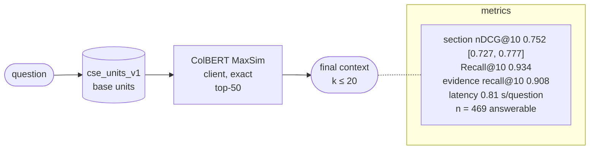

# C1-units-gateoff-v1-b814c18d

C1: ColBERT MaxSim over all units · index `units` · gate off · params `v1` · config `b814c18d8312`

| comparison | Δ section nDCG@10 | 95% CI | p (Holm) |
|---|---|---|---|
| RQ1 C1 vs L1 | +0.091 | [+0.062, +0.120] | 0.0006 |
| RQ7 C1@win500 vs C1@units | +0.014 | [+0.002, +0.026] | 0.0592 |
