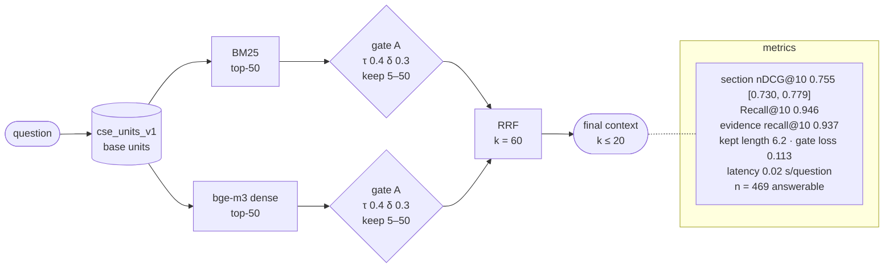

# H1-units-gateon-v1-9f5e5fd2

H1: BM25 + dense, RRF · index `units` · gate on · params `v1` · config `9f5e5fd2f264`

| comparison | Δ section nDCG@10 | 95% CI | p (Holm) |
|---|---|---|---|
| RQ2 H1 vs L1 | +0.113 | [+0.095, +0.132] | 0.0008 |
| RQ2 H1 vs D1 | +0.029 | [+0.012, +0.047] | 0.0096 |
| RQ2 H2 vs H1 | -0.009 | [-0.020, +0.001] | 0.2968 |
| RQ3 X1 vs H1 | -0.011 | [-0.028, +0.006] | 0.4216 |
| RQ3 X2 vs H1 | +0.077 | [+0.060, +0.093] | 0.0006 |
| RQ5 F1 vs H1 | +0.016 | [+0.004, +0.027] | 0.0264 |
| RQ5 T1 vs H1 | +0.004 | [+0.001, +0.008] | 0.0460 |
