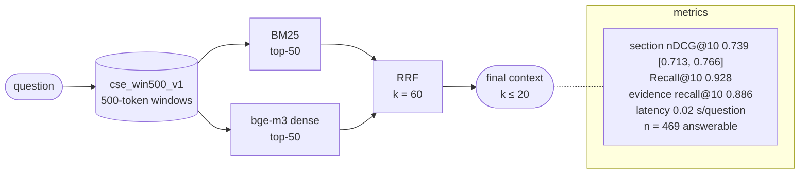

# H1-win500-gateoff-v1-9d5dfb15

H1: BM25 + dense, RRF · index `win500` · gate off · params `v1` · config `9d5dfb150d1e`

| comparison | Δ section nDCG@10 | 95% CI | p (Holm) |
|---|---|---|---|
| RQ2 H1 vs L1 | +0.074 | [+0.058, +0.090] | 0.0008 |
| RQ2 H1 vs D1 | -0.016 | [-0.036, +0.004] | 0.5829 |
| RQ2 H2 vs H1 | -0.004 | [-0.015, +0.007] | 0.9267 |
| RQ3 X1 vs H1 | +0.057 | [+0.038, +0.076] | 0.0006 |
| RQ3 X2 vs H1 | +0.125 | [+0.104, +0.146] | 0.0006 |
| RQ5 F1 vs H1 | +0.024 | [+0.012, +0.036] | 0.0008 |
| RQ5 T1 vs H1 | +0.004 | [+0.001, +0.007] | 0.0114 |
| RQ7 H1@win500 vs H1@units | -0.005 | [-0.015, +0.005] | 0.6617 |
